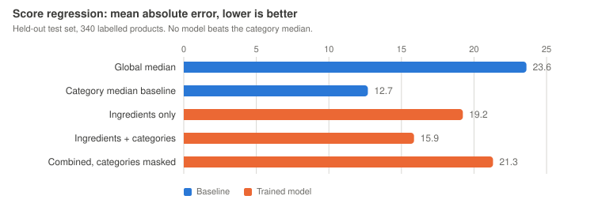
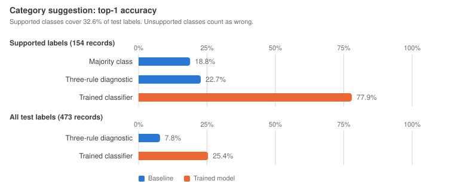

# PAIBS Group 6 category completion and review

[](https://github.com/josemita87/paibs-group6-green-score/actions/workflows/checks.yml)

A working research prototype that suggests product categories from ingredient text for Open Food Facts contributors to review. The original Green-Score regression experiment is retained as a negative result.

## Main findings

- Official pinned OFF sample: 12,288 records; 4,039 usable numeric score labels, 1,629 eligible for the regression scope.
- Score regression MAE: 15.87; category median baseline: 12.69 points. The model loses to the baseline. Categories removed: 21.31.
- Category classifier: 20 supported recorded classes; 428 training records. Top-1 accuracy 77.9% on 154 supported test records, covering 32.6% of the 473 broader test records.
- Across all test labels, top-1 accuracy is 25.4%; top-3 accuracy 30.7%. Unsupported classes are counted as wrong.
- A fixed class-score threshold of 0.50 yields 123 accepted test predictions; 65.9% match the recorded label across all test classes. This is **not** accuracy on genuine missing categories.
- An assisted text-only desk review of 20 pre-filter suggestions found four plausible new categories, eight already present, five too broad, two ambiguous and one implausible. It is not contributor-validated precision.
- The final queue exposes 131 suggestions after suppressing a category already present and the generic groceries category. Remaining rows abstain. Post-filter precision has not been measured.

## Results at a glance

<picture>
  <source media="(prefers-color-scheme: dark)" srcset="results/figures/regression_mae_dark.svg">
  
</picture>

<picture>
  <source media="(prefers-color-scheme: dark)" srcset="results/figures/category_accuracy_dark.svg">
  
</picture>

Both figures are drawn from `results/metrics.json` by `python make_figures.py`; no number in them is typed by hand. CI regenerates them and fails if they drift from the committed metrics.

## Run the included demo

Python 3.12 was used. No API key or GPU is needed.

```sh
python3 -m venv .venv
source .venv/bin/activate
python -m pip install -r requirements.txt
python prototype.py test
python prototype.py serve
```

Open http://127.0.0.1:8765. On Windows activate with `.venv\Scripts\activate`.
The compressed data sample, trained model and results are included; you do not need to fetch data again to run the demo.

```sh
python prototype.py train
python prototype.py predict --code 0084114112514
```

`model.pkl` is a locally generated pickle. Load only the trusted artifact shipped with this repository; regenerate it with `train` if library versions differ.

## Reproduce the sample

```sh
python -m pip install -r requirements-fetch.txt
python fetch_data.py
python prototype.py train
```

Dataset: https://huggingface.co/datasets/openfoodfacts/product-database
Pinned revision: `89cfb571db20b1f1b246f27cab71837fc96225b1`. Twelve pseudorandom Parquet row groups use seed 20261027. The sample is clustered in barcode order and is **not representative of all OFF products**. The manifest records source row groups and SHA256 of the uncompressed JSONL. `fetch_data.py` caches downloaded row groups in an ignored directory.

## Architecture

Pinned OFF sample -> multilingual parsing and grouped splits -> trained category classifier -> candidates plus abstention -> contributor evidence check.

Regression uses ingredient text plus categories. Category classification uses ingredient text only. Both use character TF-IDF. Ridge alpha is 10; logistic regression C is 4 with at most 1000 iterations. Settings are fixed, not tuned against reported test results.

The category label is the last recorded tag, not necessarily the most specific or correct category. Classes require eight training examples and occur on a scored product somewhere in this sample. Broad labels and inconsistent case exist in the source. The next label-quality experiment should define canonical specific taxonomy nodes.

Training, calibration and test partitions have no shared exact-match groups. Groups unite identical normalized ingredient text or identical normalized name plus brand. This does not guarantee all near duplicates are removed.

The score target uses explicit France-context `scores.fr` in all 1629 eligible records. Original scores range from -20 to 123; zero is valid. Do not replace unknown or not-applicable with zero, or clip genuine labels silently.

A diagnostic three-condition keyword baseline reaches 22.7% accuracy on supported labels and 7.8% across all test labels. It checks potato ingredients, an initial milk token and cocoa, otherwise returning the training majority. This was added after the initial analysis; it is a diagnostic, not a preregistered result.

## Review semantics

Suggestions are provisional. Class scores are uncalibrated and can be confidently wrong on unsupported categories. No category is written into OFF and no numerical Green-Score is recommended for filling. Evidence from the ingredient list, product label and official category taxonomy is required before a contributor changes data. A predicted category might still not unlock an Agribalyse mapping.

See `results/desk_review_20.csv` for the assisted desk review and `review_log_template.csv` for further participant or contributor review.

## Evidence and project records

- `data/manifest.json` and `data/off_sample.jsonl.gz`: immutable sample and provenance.
- `results/metrics.json`: both experiments, coverage and limitations.
- `results/splits.csv`, `results/category_splits.csv`: partition audit.
- `results/test_predictions.csv`, `results/category_test_predictions.csv`: held-out predictions.
- `results/subgroups.csv`: score-regression errors by language, category and sale country when sample counts permit.
- `results/review_queue.csv`: current suggested action or abstention.
- `TASK_BOARD.md`, `DECISION_LOG.md`: owners, state and decisions.
- `docs/`: prepared English submission documents.

This initial implementation and its first commit are assisted preparation. They do not represent independent commits by every group member or a record of earlier class decisions. eCampus identifies Group 6; the Miro team area has a different visual team number. See the documents for the verified roster.

## Sources and attribution

Contains information from Open Food Facts, made available under the Open Database License (ODbL). Individual contents use the Database Contents License. No product image binaries are included. Preserve source, snapshot and licence when redistributing this sample.

Official computation: https://github.com/openfoodfacts/openfoodfacts-server/blob/main/lib/ProductOpener/EnvironmentalScore.pm
Contribution workflow: https://openfoodfacts.github.io/openfoodfacts-server/api/tutorials/get-the-green-score/
Existing Robotoff system: https://openfoodfacts.github.io/openfoodfacts-server/api/intro-robotoff/
Schema change log: https://openfoodfacts.github.io/openfoodfacts-server/api/ref-api-and-product-schema-change-log/
Licence guidance: https://openfoodfacts.github.io/openfoodfacts-server/api/tutorials/license-be-on-the-legal-side/
